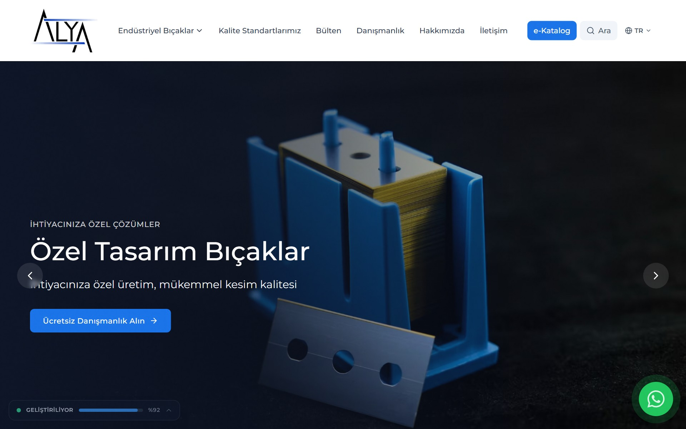

# Alya Bıçak

Website and product catalogue for an industrial blade supplier: industrial razor blades, machine knives, vacuum packaging blades and safety knives. Buyers browse by category and sub-category, open product pages and request a quote by email. The site is in Turkish.

**Live demo:** [alyabicak.vercel.app](https://alyabicak.vercel.app)



## Stack

- [Next.js 16](https://nextjs.org) (App Router, static generation)
- React 19 and TypeScript
- Tailwind CSS 3
- Framer Motion
- Node.js scraper (Cheerio) used once to move the old catalogue

## What is in it

- Catalogue with 4 categories and more than 25 sub-categories, generated at build time.
- Product pages with variants, specification tables and a quote request that opens a prefilled email.
- Downloadable PDF catalogues per product line (`public/catalogs`).
- SEO: per-page metadata, sitemap, robots and JSON-LD.
- Legal pages (privacy notice, cookie policy) and a newsletter page.
- Security headers in `next.config.js`.

## Project structure

```
industrial-blades/          the Next.js app
  app/                      routes: kategoriler, urunler, katalog, hakkimizda, iletisim ...
  components/               layout, product, category and UI components
  lib/
    types/                  shared TypeScript types
    data/
      categories.ts         categories and sub-categories
      products.ts           hand-written products + scraped catalogue
      scraped-products.json catalogue moved from the old site
      products-extended.ts  products with full detail pages
    services/               category and product queries used by the pages
    seo.ts                  metadata and JSON-LD helpers
  public/                   images, videos, PDF catalogues
scraper/                    one-off migration scripts for the old catalogue
assets/                     brand source files
```

## Run locally

Requires Node.js 20 or newer.

```bash
cd industrial-blades
npm install
npm run dev
```

Open http://localhost:3000.

## Adding a product

- **Listed in the catalogue:** add an object to `MANUAL_PRODUCTS` in `lib/data/products.ts`. Make sure `categoryId` and `subcategoryId` exist in `lib/data/categories.ts`.
- **With its own detail page:** also add it to `PRODUCTS_EXTENDED` in `lib/data/products-extended.ts`. The `/urunler/[slug]` pages are generated from this list.
- Put the image in `public/images/products/` and run `npm run build` to check the new pages.

## Catalogue migration

The products came from the supplier's previous website. `scraper/scraper.js` reads the old category pages and the other scripts clean the result (duplicate IDs, sub-category mapping) before it lands in `lib/data/scraped-products.json`. It is kept for reference and is not part of the build.

## Credits

Design, build and product photography by [commitius](https://commitius.com).
